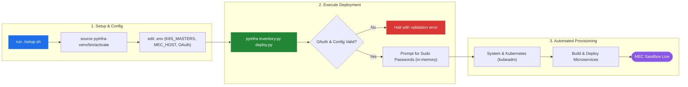

# ETSI MEC Sandbox Automated Deployment Guide

This guide walks you through deploying the **ETSI MEC Sandbox** using our automated, Python-based infrastructure-as-code ([PyInfra](https://pyinfra.com/)) framework.

The framework automates the entire provisioning lifecycle—including kernel tuning, Docker/Containerd runtime installation, Kubernetes (`kubeadm`) cluster initialization, development tools (Go, Node.js, NVM), and compiling and running the MEC Sandbox microservices (`meepctl`).

---

## Automated Deployment Workflow

The diagram below illustrates the automated deployment workflow from setup and `.env` configuration to validation and execution:



---

## Prerequisites

Before deploying, ensure your target machine(s) meet the following requirements:
- **Operating System:** Ubuntu 20.04/22.04 LTS (or Debian-compatible Linux).
- **Python:** Python 3.8+ installed on the machine running this deployment.
- **Privileges:** Sudo (root) access on the target deployment machines.
- **Network:** Outbound internet access to download required containers, packages, and binaries.

---

## Quick Start (3 Steps)

### Step 1: Initialize the Deployment Environment
Run the automated setup script to verify Python 3, create an isolated virtual environment (`pyinfra-venv`), and install all required deployment dependencies:

```bash
cd ~/etsi-mec-sandbox/deploy/pyinfra
./setup.sh
```

### Step 2: Configure Your Environment (`.env`)
The first time you run `./setup.sh`, it generates a `.env` configuration file from `.env.example` and pauses so you can enter your settings.

Open `.env` in your text editor and configure the following required fields:
- **`K8S_MASTERS`:** Mandatory target host for the Kubernetes control plane (<strong style="color: #d9822b;">exactly 1 master node is supported</strong>; e.g., `localhost` for local deployments, or `ubuntu@192.168.1.10` for remote servers).
- **`K8S_WORKERS`:** Optional comma-separated list of worker node IPs/hostnames. Leave blank (`""`) for single-machine deployments.
- **`MEC_HOST_ADDRESS`:** The routable IP address or domain name where the MEC Sandbox frontend will be accessible (e.g., `127.0.0.1`, `192.168.1.100`, or `mec.example.com`).
- **OAuth Provider Credentials:** Provide valid OAuth secrets for **GitHub** (`GITHUB_CLIENT_ID`, `GITHUB_CLIENT_SECRET`), **GitLab**, or both. Unconfigured providers are automatically disabled in the platform configuration.

> ! IMPORTANT</br>
> <strong style="color: #e51400;">DO NOT set both <code>K8S_MASTERS</code> and <code>K8S_WORKERS</code> to <code>localhost</code>.</strong>  
> A single machine cannot act as both an independent Kubernetes master and worker node. For an all-in-one sandbox on your local machine, set `K8S_MASTERS="localhost"` and leave `K8S_WORKERS=""`.

### Step 3: Run the Deployment
Activate the virtual environment and launch the deployment:

```bash
source pyinfra-venv/bin/activate
pyinfra inventory.py deploy.py
```

---

## Authentication & Sudo Passwords

For security, <strong style="color: #e51400;">sudo passwords are NEVER stored in config files or environment variables.</strong>

When you launch `pyinfra inventory.py deploy.py`:
1. **Prompted Once at Startup:** PyInfra will <strong style="color: #28a745;">prompt you interactively once at startup</strong> in the terminal for your sudo password:
   ```text
   Enter sudo password for K8S_MASTERS node(s) (press Enter for passwordless sudo):
   ```
2. **Worker Credentials (If Applicable):** If you configured remote `K8S_WORKERS`, you will be prompted separately for the worker nodes' sudo password.
3. **Non-Interactive Execution:** After entering your password at startup, PyInfra caches it in memory and automatically authenticates all sudo operations in the background. You will not be prompted again during the deployment.

---

## Deployment Modes

### Option A: Local / Single-Machine Deployment (Default)
To deploy the entire MEC Sandbox directly on the machine you are currently logged into:
1. Set `K8S_MASTERS="localhost"` and `K8S_WORKERS=""` in `.env`.
2. Execute:
   ```bash
   source pyinfra-venv/bin/activate
   pyinfra inventory.py deploy.py
   ```

### Option B: Remote / Multi-Node Kubernetes Cluster
To deploy across multiple remote servers:
1. **Configure Targets in `.env`:** Specify target remote hosts in <strong style="color: #d9822b;">mandatory <code>&lt;username&gt;@&lt;ip&gt;</code> format</strong> (note: <strong style="color: #d9822b;">exactly 1 master node is supported</strong> for the control plane):
   ```env
   K8S_MASTERS="ubuntu@192.168.1.10"
   K8S_WORKERS="ubuntu@192.168.1.11,admin@192.168.1.12"
   ```
2. **Execute Deployment & Provide Sudo Passwords:**
   ```bash
   source pyinfra-venv/bin/activate
   pyinfra inventory.py deploy.py -y
   ```
   - **Mandatory Sudo Prompts:** Installing system packages and Kubernetes requires root privileges (`sudo`). PyInfra will interactively prompt you for the sudo password of your `K8S_MASTERS` nodes (and separately for `K8S_WORKERS`, if configured). Press **Enter** if the target account has passwordless sudo enabled on the remote server.

---

## Resuming Interrupted Deployments

The deployment process is <strong style="color: #28a745;">idempotent and checkpointed</strong>:
- Long-running stages (such as compiling `meepctl` binaries and packaging container images) create checkpoint markers automatically.
- If your network disconnects or an execution is interrupted, simply re-run `pyinfra inventory.py deploy.py`.
- The installer will skip all completed stages and resume immediately from the last checkpoint without restarting from scratch.

---

<!-- ## Redeployment & Troubleshooting

### Full Redeployment of the Sandbox
The deployment lifecycle creates checkpoint markers in `~/.meep/` to track completed stages:
- `~/.meep/.01_secrets_configured`
- `~/.meep/.02_deps_deployed`
- `~/.meep/.03_binaries_built`
- `~/.meep/.04_images_dockerized`
- `~/.meep/.05_scenarios_imported`

To perform a <strong style="color: #28a745;">full clean redeployment</strong> of the sandbox, <strong style="color: #d9822b;">remove these checkpoint files</strong> and re-run the deployment command:

```bash
rm -f ~/.meep/.01_secrets_configured ~/.meep/.02_deps_deployed ~/.meep/.03_binaries_built ~/.meep/.04_images_dockerized ~/.meep/.05_scenarios_imported
source pyinfra-venv/bin/activate
pyinfra inventory.py deploy.py -y
``` -->

### Single Component Redeployment & Troubleshooting
For redeploying a single microservice component or diagnosing specific container issues, refer to the official troubleshooting guide:
- [MEEPCTL Troubleshooting & Single Component Guide](https://labs.etsi.org/rep/mec/etsi-mec-sandbox-frontend/-/blob/STF_685/guides/meepctl-troubleshooting.md?ref_type=heads)
