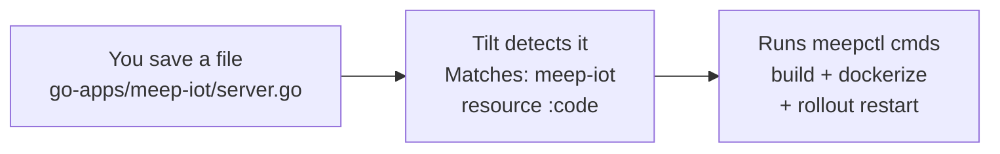

# Tilt — Automated Dev Workflow for MEC Sandbox

> **Purpose:** Tilt watches your source code and Helm charts for changes, then automatically runs the correct `meepctl` build/dockerize/deploy pipeline — eliminating manual rebuild steps during development.

---

## Table of Contents

- [Quick Start](#quick-start)
- [How It Works](#how-it-works)
- [Resource Groups](#resource-groups)
  - [Core Apps (auto-watched)](#core-apps-auto-watched)
  - [Sandbox MEC API Apps (auto-watched)](#sandbox-mec-api-apps-auto-watched)
  - [meep-virt-engine (special)](#meep-virt-engine-special)
  - [Dependencies (manual buttons)](#dependencies-manual-buttons)
  - [Utilities (manual buttons)](#utilities-manual-buttons)
- [Automation Rules](#automation-rules)
- [Configuration](#configuration)
- [Tilt UI](#tilt-ui)
- [Troubleshooting](#troubleshooting)

---

## Quick Start

**Prerequisites:**
- Platform must already be deployed (`meepctl deploy dep` + `meepctl deploy core`)
- [Tilt](https://tilt.dev/) must be installed (`curl -fsSL https://raw.githubusercontent.com/tilt-dev/tilt/master/scripts/install.sh | bash`)

**Start watching:**
```bash
cd ~/etsi-mec-sandbox
tilt up
```

**Open the dashboard:**
- Local: http://localhost:10350
- Remote: `tilt up --host 0.0.0.0` then visit http://<VM-IP>:10350

**Stop watching:**
```bash
tilt down
```

> **Note:** `tilt up` does NOT deploy anything automatically. It only starts watching for file changes. Your running platform is not affected until you save a file.

---

## How It Works

Tilt wraps `meepctl` commands. When you save a file, Tilt detects the change and runs the appropriate pipeline:



### What Tilt does vs. what you had to do manually

| Scenario | Before (manual) | After (with Tilt) |
|----------|-----------------|-------------------|
| Edit `go-apps/meep-federation/` | `meepctl build meep-federation` → `meepctl dockerize meep-federation` → restart pods | **Click "Trigger" button in Tilt GUI** |
| Edit `charts/meep-federation/` | `meepctl dockerize meep-virt-engine` → `meepctl deploy core meep-virt-engine -f` | **Just save the file** (Auto) |
| Edit `go-apps/meep-platform-ctrl/` | `meepctl build` → `meepctl dockerize` → `meepctl deploy core meep-platform-ctrl -f` | **Just save the file** (Auto) |
| Edit `charts/meep-platform-ctrl/` | `meepctl deploy core meep-platform-ctrl -f` | **Just save the file** (Auto) |

---

## Resource Groups

### Core Apps (auto-watched)

Each core app has two Tilt resources:

| Resource | Watches | Triggers |
|----------|---------|----------|
| `<app>:code` | `go-apps/<app>/` | `meepctl build` → `meepctl dockerize` → `meepctl deploy core <app> -f` |
| `<app>:chart` | `charts/<app>/` | `meepctl deploy core <app> -f` |

**Core apps monitored:**
- `meep-auth-svc`
- `meep-mon-engine`
- `meep-platform-ctrl`
- `meep-sandbox-api`
- `meep-virt-engine` *(special handling — see below)*
- `meep-webhook`
- `meep-ingress-certs` *(chart only, no Go code)*

---

### Sandbox MEC API Apps (manual-trigger)

Each sandbox app has one Tilt resource configured in manual trigger mode (`TRIGGER_MODE_MANUAL`) so that file changes do not trigger builds automatically. Instead, Tilt watches the files and shows a manual trigger button in the GUI when there are pending changes:

| Resource | Watches | Trigger Type | Action |
|----------|---------|--------------|--------|
| `<app>:code` | `go-apps/<app>/` | **Manual (GUI)** | `meepctl build` → `meepctl dockerize` → `kubectl rollout restart` on all deployments using that image |

The restart step automatically finds all K8s deployments using the app's Docker image across all namespaces (since sandbox deployments have dynamic names like `mep1-mec033-1`).

**Sandbox apps monitored:**

| App | MEC Standard |
|-----|-------------|
| `meep-ams` | MEC021 |
| `meep-app-enablement` | MEC011 |
| `meep-dai` | MEC016 |
| `meep-federation` | MEC040 |
| `meep-gis-engine` | — |
| `meep-iot` | MEC033 |
| `meep-loc-serv` | MEC013 |
| `meep-metrics-engine` | — |
| `meep-rnis` | MEC012 |
| `meep-sandbox-ctrl` | — |
| `meep-sss` | MEC046 |
| `meep-tm` | MEC015 |
| `meep-vis` | MEC030 |
| `meep-wais` | MEC028 |

---

### meep-virt-engine (special)

`meep-virt-engine` gets special treatment because it bundles **all sandbox Helm charts** inside its Docker image. It has three resources:

| Resource | Watches | Triggers |
|----------|---------|----------|
| `meep-virt-engine:code` | `go-apps/meep-virt-engine/` | build → dockerize → deploy -f |
| `meep-virt-engine:chart` | `charts/meep-virt-engine/` | deploy -f |
| `meep-virt-engine:sandbox-charts` | `charts/meep-ams/`, `charts/meep-rnis/`, `charts/meep-iot/`, ... (all 14 sandbox charts) | dockerize meep-virt-engine → deploy -f |

**This is the key automation:** When you edit _any_ sandbox Helm chart, Tilt automatically re-dockerizes `meep-virt-engine` (to bundle the updated chart) and redeploys it.

---

### Dependencies (manual buttons)

Dependencies are third-party infrastructure services that rarely change. They appear as **manual buttons** in the Tilt UI — click to trigger.

| Button | Command |
|--------|---------|
| `dep:deploy-all` | `meepctl deploy dep` |
| `dep:delete-all` | `meepctl delete dep` |
| `dep:meep-grafana` | `meepctl deploy dep meep-grafana --force` |
| `dep:meep-couchdb` | `meepctl deploy dep meep-couchdb --force` |
| *(+ 11 more individual dep buttons)* | |

---

### Utilities (manual buttons)

| Button | Command | Use case |
|--------|---------|----------|
| `util:deploy-core-all` | `meepctl deploy core` | Deploy all core apps |
| `util:delete-core-all` | `meepctl delete core` | Delete all core apps |
| `util:build-all` | `meepctl build all` | Rebuild everything |
| `util:dockerize-all` | `meepctl dockerize all` | Re-dockerize everything |
| `util:docker-prune` | `docker image prune -f` | Clean up old images |
| `util:pod-status` | `kubectl get pods -A \| grep meep-` | Quick pod health check |

---

## Automation Rules

Complete reference of what happens when each type of file changes:

| File changed | Tilt resource triggered | Trigger Type | Commands executed |
|-------------|------------------------|--------------|-------------------|
| `go-apps/meep-platform-ctrl/**` | `meep-platform-ctrl:code` | Auto | build → dockerize → `meepctl deploy core meep-platform-ctrl -f` |
| `charts/meep-platform-ctrl/**` | `meep-platform-ctrl:chart` | Auto | `meepctl deploy core meep-platform-ctrl -f` |
| `go-apps/meep-iot/**` | `meep-iot:code` | **Manual** (GUI) | build → dockerize → `kubectl rollout restart` (all deployments using meep-iot image) |
| `charts/meep-iot/**` | `meep-virt-engine:sandbox-charts` | Auto | `meepctl dockerize meep-virt-engine` → `meepctl deploy core meep-virt-engine -f` |
| `go-apps/meep-virt-engine/**` | `meep-virt-engine:code` | Auto | build → dockerize → `meepctl deploy core meep-virt-engine -f` |
| `charts/meep-virt-engine/**` | `meep-virt-engine:chart` | Auto | `meepctl deploy core meep-virt-engine -f` |

> **Ignored paths:** `vendor/` directories are excluded from watching to avoid false triggers.

---

## Configuration

The Tiltfile has three configurable lists at the top:

```python
# Core apps (auto-watched for code + chart changes)
CORE_APPS = ['meep-auth-svc', 'meep-mon-engine', ...]

# Sandbox MEC API apps (manual trigger for code changes)
SANDBOX_APPS = ['meep-ams', 'meep-iot', 'meep-federation', ...]

# Dependencies (manual buttons only)
DEP_APPS = ['meep-grafana', 'meep-couchdb', ...]
```

To stop watching a specific app, remove it from the list. To add a new app, add it to the appropriate list.

---

## Tilt UI

The Tilt dashboard (http://localhost:10350) shows:

- **Resource status** — green (healthy), yellow (building), red (error)
- **Build logs** — click any resource to see its build output
- **Manual triggers** — click the trigger button on dep/util resources
- **Filter by label** — use the sidebar to filter by `core`, `sandbox`, `dep`, or `util`

---

## Troubleshooting

### Tilt not detecting file changes

```bash
# Check if inotify limit is too low (common on Linux)
cat /proc/sys/fs/inotify/max_user_watches

# Increase if needed
echo 65536 | sudo tee /proc/sys/fs/inotify/max_user_watches
```

### Resource stuck in error state

Click the resource in the Tilt UI to see the error log. Common causes:
- `meepctl` not in PATH
- K8s cluster not accessible
- Helm release in failed state (fix with `helm uninstall <name>`)

### Tilt using too many resources

If watching all 14 sandbox apps is too noisy, edit the `SANDBOX_APPS` list in the Tiltfile to only include apps you're actively developing:

```python
SANDBOX_APPS = [
    'meep-iot',        # Only watch the apps you're working on
    'meep-federation',
]
```

### Stop and restart Tilt

```bash
tilt down    # Stop cleanly
tilt up      # Start again
```

### Running Tilt on a remote VM

```bash
# Bind to all interfaces so you can access the UI from your local machine
tilt up --host 0.0.0.0

# Then visit http://<VM-IP>:10350 from your browser
```
